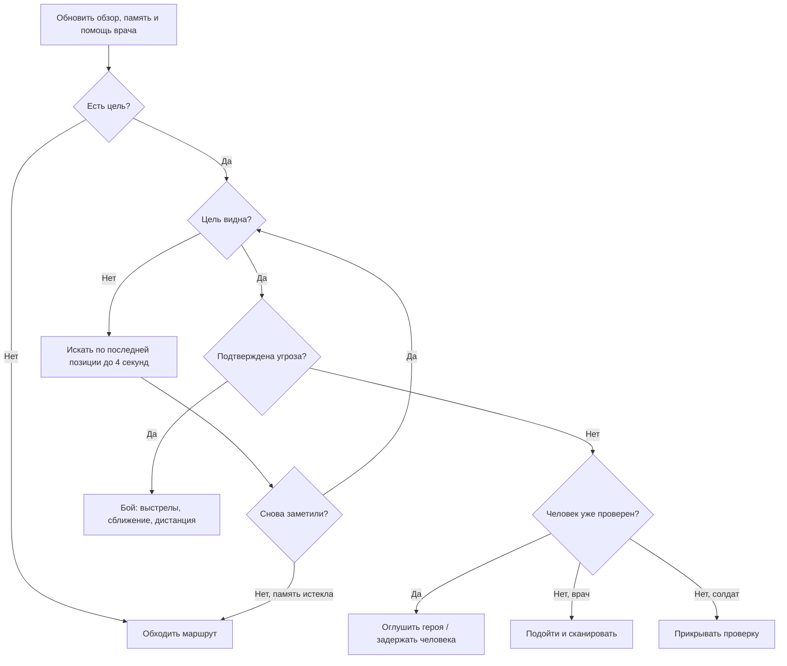

# Дерево поведения NPC

В Unity включи **Play**, открой **Irkutsk → NPC Behavior Tree** и нажми кнопку нужного персонажа. Окно показывает цель, состояние и дерево. Жёлтым выделено выполняемое действие, зелёным — успешная проверка, красным — отказ, серым — узлы, не проверявшиеся в текущем кадре. Это окно наблюдения; состав веток задаётся в `HumanAgent.BuildBehavior()`, перетаскивания узлов пока нет.

Каждый персонаж имеет собственное дерево и собственную память. Селектор проверяет ветки сверху вниз и выбирает первую подходящую. Последовательность выполняет дочерние узлы до отказа или действия в процессе. У узла три результата: успех, отказ и выполнение. Приоритеты проверяются заново каждый кадр, поэтому угроза может сразу прервать мирную проверку.

Перед этой частью проверяются оглушение, смерть и конец забега. Задержанный идёт в карантин. Мирные, мародёры и заражённые теперь тоже имеют собственные ветки дерева; заражённых можно выбрать в окне наблюдения.

Здорового героя сначала проверяют, затем пытаются задержать. Подтверждённое заражение или нападение разрешает солдату стрелять. Врач использует дротики; рядом лечит себя и солдата с прежним интервалом. Известная позиция нападавшего передаётся ближайшему напарнику. Обычное обнаружение по-прежнему требует попадания в сектор обзора и прямой видимости.

Потеря цели не даёт NPC знания о её новом положении: он запоминает последнюю видимую позицию. Через 4 секунды без нового контакта цель забывается. Оружие, поиск пути, ограничения сканера и результаты проверки героя остаются отдельными игровыми системами; дерево выбирает, какое действие сейчас выполнять.

## Реакции разных NPC

- **Мирный:** замечает заражённого или мародёра в секторе до 8 м, пугается выстрела до 8 м (до 3 м через стену), запоминает опасное место на 6 секунд и уходит от него. После успокоения возвращается на исходное место. Не стреляет в ответ; просьба о лекарстве остаётся доступной рядом с ним.
- **Врач:** при здоровье напарника ниже 65 подходит к нему с расстояния до 12 м, если рядом нет непосредственной видимой угрозы. Лечит только вблизи, с интервалом 8 секунд. При собственном здоровье ниже 50 отступает с дротиками.
- **Солдат:** не стреляет по центральной линии через других персонажей, смещается в сторону, затем возобновляет огонь. При здоровье ниже 35 ищет более безопасную позицию и может вести ответный огонь. Подтверждённая угроза или позиция нападавшего передаётся патрульным в радиусе 12 м.
- **Мародёр:** удерживает цель, ищет её последнюю позицию до 4 секунд, меняет перекрытую позицию, отходит от слишком близкой цели. При здоровье ниже 40 отступает, продолжая стрелять при видимом противнике.
- **Заражённый:** прислушивается к одиночному слабому звуку, после накопления подозрения начинает поиск с прежней задержкой. Видимую добычу помнит 6 секунд, источник шума или удара — 4 секунды; после прибытия осматривает соседние точки. Укус требует замаха 0,35 с; если цель ушла из зоны удара, замах сбрасывается.

Отступление выбирает из нескольких ближайших свободных точек, предпочитая увеличение расстояния и закрывающие обзор препятствия. Это простой локальный выбор, а не полноценное планирование укрытий и обходов с фланга. Центральная линия огня проверяется до выстрела, но разброс сохраняется. Небольшое взаимное расталкивание уменьшает скопления, не гарантируя отсутствие всех застреваний в тесных местах. Дальность зрения и слуха заражённых не увеличена.

## Этап 1 — слух людей и обмен информацией

Солдат, врач и мародёр получают события шума с местом, громкостью и типом. Обычные шаги слышны до 2,5 м, бег и ремонт — до 6 м, удар рукой — до 4 м, вскрытие магазина — до 8 м, двигатель — до 10 м, выстрел героя — до 14 м, NPC — до 12 м. Стена на прямом пути звука уменьшает радиус до 40%. Это простая модель приглушения, без распространения звука через двери и коридоры.

Один тихий звук вызывает прислушивание до 2,5 с без движения. Два близких тихих звука за этот интервал либо один громкий создают зацепку. Звуки обрабатываются не чаще четырёх раз в секунду; выстрелы имеют приоритет и не теряются из-за шагов в том же кадре. Патруль игнорирует свои и напарников выстрелы как подозрительные источники. Ctrl не создаёт шума шагов.

Зацепка содержит приблизительную точку на сетке 2 м и живёт до 8 с после последнего подтверждающего звука; стрельба продлевает поиск до 20 с. NPC ждёт 0,4 с, затем идёт к ней со скоростью 1,35 м/с и осматривается 2 с после прибытия для обычных звуков; при стрельбе — до конца двадцатисекундного срока. Недавняя проверенная точка не проверяется повторно 2,5 с из-за обычного шума; свежий выстрел позволяет проверить её снова. Слышимость не ограничивается сектором зрения. Вне поля зрения звук не даёт личности источника и не разрешает стрельбу; скрытое перемещение источника не обновляет зацепку без нового звука.

В деревья добавлены ветки «Прислушаться» и «Осторожно проверить». Видимая цель и помощь раненому сохраняют приоритет. После зрительного обнаружения звуковая зацепка отменяется и начинается обычная проверка либо бой по прежним правилам. Поиск потерянной цели идёт к последней известной позиции со скоростью 1,6 м/с, безрезультатный поиск заканчивается через прежние 4 с.

Патруль сообщает напарнику в пределах 12 м снимок замеченной позиции, с интервалом 1,5 с между такими сообщениями. Получатель может повернуться и искать там, но не знает нового скрытого положения цели. Нейтральное сообщение не прерывает текущую визуальную проверку или поиск известной угрозы; сообщение о подтверждённой угрозе может прервать мирную проверку. В окне наблюдения показана активная звуковая зацепка.

В этом этапе новые укрытия, приседание, спасение тяжелораненых и сбор добычи мародёром не добавлялись; это следующие согласованные этапы.

## Этап 2 — укрытия и высота персонажа

Добавлены `CoverObstacle` и бронируемые места `CoverSlot`, низкий и высокий префабы. В основной сцене они не размещены. Солдат, врач и мародёр могут выбрать защищённое доступное место, присесть за низким препятствием, выйти к точке выглядывания, выстрелить при видимости и вернуться. Занятое место недоступно другим; бронь освобождается при уходе, отключении, смерти или по истечении аренды.

Персонаж получает `ActorPosture`: C меняет высоту героя с 1,8 до 1 м, коллайдер и кубический силуэт, высоту глаз и оружия. Встать под низким потолком нельзя. Обзор проверяет голову и корпус, туман войны скрывает персонажей с учётом позы, а пули сталкиваются с геометрией. Передвижение в приседе медленное, его шум — 1,25 м; Ctrl по-прежнему бесшумен.

Проверочная сцена **Irkutsk → Open Cover Sandbox** содержит образцы отдельно от основной карты. Для добавления будущих препятствий и настройки своих объектов смотри [инструкцию укрытий](CoverGuide.md). Распределение боевых ролей и спасение тяжелораненых остаются следующими этапами.

## Этап 3 — тактика пары и безопасная помощь

В подтверждённом бою солдат и врач выбирают удержание, сближение, отход, смену линии огня или укрытие. Решение удерживается около 0,9 с; близкий противник, перекрытый путь и опасность лечения могут немедленно его прервать. Сближение идёт короткими доступными отрезками до 2 м. При отсутствии продвижения NPC прекращает попытку, выдерживает паузу и оценивает позицию снова. Потерянная цель ищется по прежней памяти, без чтения её скрытого положения.

В пределах 12 м живые активные напарники согласуют перемещения: один перемещается, другой удерживает позицию и стреляет при видимости и свободной линии. Выглядывание из укрытия тоже учитывается как перемещение. Сильное ранение или противник ближе 2,5 м разрешают срочный отход обоим. При выключенном, оглушённом, погибшем или удалённом напарнике NPC действует самостоятельно. Солдат прикрывает подход врача к раненому.

Врач не лечит в течение 1,25 с после попадания в него или пациента. Он проверяет свою и переданную напарником память об угрозах, близость врага до 7 м и перекрывающую обзор геометрию. Для подхода проверяются прямой свободный путь и четыре точки на нём. Если путь опасен или перекрыт, помощь откладывается; врач продолжает бой, удерживает позицию либо отступает. Это ограниченная локальная оценка, без расчёта всех возможных обходов. Лечение по-прежнему восстанавливает 15 HP с интервалом 8 с и дистанции до 3 м, теперь также требует отсутствия стены между врачом и пациентом.

В окне **Irkutsk → NPC Behavior Tree** показаны тактическая задача и оставшееся время удержания. Для ручной проверки пары в отдельной песочнице: F7 включает бой, F9 добавляет врача, F10 понижает здоровье живого солдата до 40 HP. Спасение и поднятие тяжелораненых относится к этапу 4.

## Этап 4 — тяжёлое ранение и спасение

У солдат и врачей появилось состояние `IsIncapacitated`, отдельное от окончательной смерти `Downed`. Первое попадание, оставившее здоровье от 0 до −40 без включения нижней границы, выводит патрульного из боя. Он падает, освобождает укрытие, перестаёт ходить, стрелять, сканировать и задерживать. Капсула движения отключается; лежащее тело сохраняет отдельный коллайдер и остаётся доступным для попаданий. Подпись показывает 30-секундный срок до гибели.

Сильный избыточный урон (здоровье ≤ −40), повторное смертельное ранение после поднятия, 20 единиц урона после брони по лежащему либо истечение 30 с завершают жизнь окончательно. Поднять можно один раз за забег. Денежный штраф и потеря репутации за убийство начисляются при смерти, а не при падении; при истечении таймера учитывается источник ранения, при добивании — источник последнего урона. Повторные попадания по погибшему не повторяют штраф. Мирный и мародёр сохраняют прежнюю модель смерти.

Напарники замечают раненого в секторе до 8 м или слышат его местный крик: до 12 м без стены, до 5 м через стену. Крик сообщает только фиксированное место раненого. Спасение доступно в пределах 12 м, требует безопасных позиций и маршрута. Проверяются попадания за последние 1,25 с, последняя известная угроза в пределах 12 м у спасателя и ближайших активных патрульных, перекрытие обзора геометрией. Поиск не читает скрытое положение врага. За низким укрытием помощь возможна, если оно закрывает места спасателя, пациента и путь к нему.

Спасатель выбирает одну из восьми точек подхода рядом с телом и проверяет прямой путь либо существующую сетку обхода. На отрезках проверяются промежуточные точки. Неудачные планы пересматриваются не чаще раза в 0,5 с; подход ограничен 10 с. У раненого один спасатель с обновляемой арендой 0,75 с. Приоритет получает доступный врач. Другой солдат рядом удерживает позицию и прикрывает спасение, стреляя только по видимой подтверждённой угрозе со свободной линией огня.

С дистанции до 1,65 м врач приседает и помогает 3 с, возвращая 40 HP. Солдат может оказать первую помощь врачу или другому солдату за 6 с, возвращая 25 HP. Стена между ними блокирует помощь. Новая опасность, попадание, оглушение, отключение, уход пациента или гибель прерывают действие, сбрасывают прогресс и освобождают бронь. При улучшении ситуации попытка возможна снова. Поднятый NPC приходит в себя 0,8 с и возвращается к обычному дереву поведения. Это помощь на месте; перенос тел и скелетная анимация не добавлены.

В песочнице F11 тяжело ранит солдата, F12 — врача; F6 добавляет третьего солдата для проверки прикрытия. F9 включает врача, F7 — активность патруля. В окне дерева видны срок до гибели, пациент и прогресс спасения. Новые укрытия на основную карту не добавлялись.

## Этап 5 — мародёр ищет добычу

Без противника мародёр осматривает дворы и гараж по отдельным точкам поиска вместо маршрута патруля. Эти точки не зависят от фактического наличия вещей. Предметы он замечает в секторе 110° до 8 м, с проверкой луча от глаз к самому предмету. Стена и низкое укрытие могут скрыть лежащий предмет. Обзор предметов обновляется раз в 0,35 с; сохраняются до восьми наблюдений на 20 с. Невидимое перемещение вещи не обновляет запомненную точку: по прибытии NPC проверяет наличие предмета рядом и прямую видимость.

Подход использует существующий поиск пути; сбор занимает 1,2 с. Недоступная точка, отсутствие продвижения 1,5 с или подход дольше 8 с отменяют попытку; эта вещь не выбирается повторно 6 с. У предмета один действующий претендент с арендой 0,75 с. Герой может забрать уже зарезервированную вещь раньше NPC — резерв не блокирует E, при этом предмет передаётся только один раз. Переполненный рюкзак героя ничего не потребляет.

Мародёр переносит до трёх настоящих предметов: детали машины, лекарство и бронепластину. После заполнения возвращается к исходной точке и охраняет добычу. Видимая опасность, поиск потерянного противника, проверка звука и оглушение имеют приоритет перед сбором. Прерванный сбор теряет прогресс и резерв, но память наблюдения сохраняется; после опасности NPC может вернуться к вещи. Прежние стрельба, смена позиции, отступление и укрытия сохраняются. Собранные вещи пока не расходуются для самолечения или улучшения оружия.

При гибели или задержании содержимое выпадает на свободные места рядом. Возвращаются те же объекты с прежними типами и подписями; дополнительные копии деталей не создаются. Вещи можно подобрать на E, лекарство отдать жителю, а детали установить на автомобиль. Если рядом тесно, проверяются более дальние места и исходное место подбора. Повторное попадание по погибшему не создаёт новых вещей. Простое отключение NPC сохраняет его рюкзак, освобождая только текущий резерв.

Закрытый магазин защищён отдельным правилом: NPC не может взять товар до вскрытия, даже при ошибочно включённом объекте. Кража NPC не списывает деньги или репутацию героя. Метка чужого товара сохраняется после выпадения; если такой товар забирает герой, действует прежняя потеря 10 репутации без денежного штрафа. Убийство мародёра по-прежнему не штрафуется как убийство мирного.

В окне дерева показаны содержимое рюкзака, выбранный предмет и прогресс сбора. В отдельной песочнице F2 открывает тест с мародёром и тремя образцами, F3 убивает его для проверки выпадения, E подбирает вещи, F5 начинает тест заново. На основную карту добавлено новое поведение существующего мародёра; дополнительных бойцов, препятствий или бесплатных запасных деталей там не появилось.

## Врач позади солдата и лечебные дротики

В совместном бою против одной известной угрозы солдат ведёт бой, а врач выбирает позицию сзади и сбоку. Направление тыла считается от последней известной позиции противника к солдату; скрытое перемещение врага не обновляет его. Предпочтительная точка — примерно 2,8 м позади и 1,4 м сбоку. Проверяются несколько свободных прямых подходов, точка обновляется раз в 0,35 с. При перекрытых подходах используется существующий выбор отступления. Это локальная коррекция, без сложного построения строя в тесных коридорах.

Когда солдат отступает или его здоровье ниже 35, врач смещается следом вместо прежнего удержания передней позиции. Его собственная непосредственная опасность остаётся приоритетной. При обычном продвижении солдата сохраняется прикрытие; врач, уже оказавшийся впереди, исправляет позицию. Врач выбирает размеченные укрытия за боевым лидером, а при отсутствующем, оглушённом, погибшем или удалённом солдате возвращается к самостоятельному поведению. Сканирование мирного и помощь тяжелораненому сохраняют отдельные ветки.

Врач стреляет зелёным лечебным дротиком в раненого солдата с расстояния до 6 м. Дротик летит со скоростью 20 м/с и восстанавливает 15 HP только при физическом попадании в назначенного солдата, максимум до 100. Перезарядка лечения — 8 с, общая с прежним самолечением врача; стрельба снотворными по врагам имеет отдельный таймер. Стены и другие персонажи перехватывают лечебный дротик; они не получают от него лечения или урона. Дротик не воскрешает погибшего и не заменяет поднятие тяжелораненого. Для выстрела сохраняются проверки безопасного лечения и свободной линии. Боезапас в прототипе не ограничен.

## Оценка ранений героя — 26 октября 2026

Солдат, врач и мародёр ведут собственную оценку известных ранений героя. Они учитывают подтверждённые попадания по видимому герою, а также попадания союзника своей группы, если одновременно видят героя и стреляющего. Направление взгляда, сектор 110°, дальность 8 м и геометрия ограничивают наблюдение. Данные не передаются всем NPC автоматически. Промах, попадание в препятствие, урон машине и снотворное не добавляют потерю HP. При смертельном попадании учитывается фактически потерянный остаток здоровья, а не избыточный урон пули.

Оценка предполагает исходные 100 HP героя и не читает его текущее здоровье. Известный урон ограничен 0–100. После 10 с без собственного зрительного контакта с героем обнуляется как общая оценка, так и её часть от собственных попаданий. Возвращение в обзор после истечения срока начинает оценку заново. Четырёхсекундный поиск потерянной цели остаётся отдельным от десятисекундной памяти о ранениях.

Для будущих лекарств подготовлен `EscapeGame.HealHero(amount)`: метод восстанавливает здоровье до 100 и сообщает фактически восстановленное количество только NPC, видящим героя в момент завершения лечения. Они вычитают его из оценки ранений без ухода ниже нуля. Скрытое лечение не меняет их знания; повторное обнаружение героя не синхронизирует оценку с настоящим HP. Инвентарь лекарства, анимация и клавиша самолечения этим изменением не добавлены — будущая механика вызывает этот метод при завершении использования.

Преимущество признаётся при известном уроне от 40 HP, собственном здоровье от 50 HP и разнице минимум 25 HP в пользу NPC относительно его оценки героя. Солдат и мародёр могут перейти к натиску только на видимого героя, остающегося противником. Они сближаются короткими доступными отрезками со скоростью 2,7 м/с до дистанции около 3,5 м и стреляют с интервалом 0,6/0,9 с соответственно. Стены и напарники по-прежнему блокируют огонь; близкая опасность, потеря собственного преимущества и помощь раненому сохраняют приоритет. Врач остаётся в поддержке, но при таком преимуществе применяет снотворное с интервалом 3 с вместо 5 с. В окне дерева видны оценка урона, её собственная часть, предполагаемый HP героя, срок памяти и наличие преимущества.

## Баланс дальности зрения — 26 октября 2026

Общая дальность человеческого зрения `Sight.HumanRange` — 8 м при секторе 110°. Она используется солдатом, врачом и мародёром при обнаружении персонажей, распознавании агрессии и стрельбы, наблюдении за уроном/лечением и зрительном обнаружении раненого. У героя нет ограничения дальности при секторе 120°, у заражённого — 6 м / 100°, у сканера — 3,2 м. На открытом месте герой может увидеть стоящего человека на расстоянии 9 м, а человек ещё не получит зрительную цель. Стены и направление взгляда продолжают ограничивать видимость.

Радиодоклад до 12 м, слух людей до 14 м и местный сигнал раненого остаются отдельными источниками информации. Они могут сообщить место поиска, но не дают права видеть или стрелять сквозь геометрию и за пределами собственного зрительного контакта.

## Намерение выстрела героя

ShotReactionZone задаёт круг на плоскости земли без дополнительного коллайдера. Базовый радиус — 2 м; у солдата — 3 м, если в пределах 8 м нет живого заражённого или незадержанного мародёра за открытой линией видимости. Это оценка обстановки вокруг солдата, а не расширение сектора обнаружения цели.

ShotIntent проверяет отрезок пули до первого попадания до нанесения урона, поэтому смертельное попадание в заражённого остаётся допустимым. Пересечение зоны активного заражённого/мародёра разрешает стрельбу возле патруля в обоих порядках пересечения. Цель за спиной стрелка или стеной не учитывается. Прямое попадание в патруль всегда передаётся прежней реакции на урон; попадание в мирного не получает исключения от соседней враждебной зоны.

Если оправдывающей цели нет, угрожающее пересечение зоны человека требует зрительного свидетеля из патруля: герой и защищаемый человек должны быть в собственном обзоре свидетеля (8 м / 110°), кроме случая, когда свидетель сам является целью. Звук любого выстрела по-прежнему передаётся слуху. Поиск источника звука не запоминает его как доказанную агрессию. Обнаружив героя после безвредного выстрела, патруль продолжает обычную проверку. Ранее установленная враждебность не сбрасывается.

### Пролетающие пули

ReportGunfire перед оценкой допустимости выстрела передаёт патрулю настоящий отрезок полёта. HearPassingShot проецирует положение уха на этот отрезок и проверяет расстояние до 4 м и свободную линию между ближайшей точкой и слушателем. Выстрел за спину, остановленный раньше слушателя или за разделяющей стеной не создаёт такую зацепку. Дальность от дула и собственный угол зрения патрульного не ограничивают слышимость близкого пролёта.

Патруль помнит приблизительное место выстрела без ссылки на скрытого героя, поворачивается и идёт проверить. Зацепка действует до 20 с, повторная стрельба обновляет срок и осмотр; тихий шум не перезаписывает активную проверку стрельбы. Видимую текущую цель и поиск известной угрозы близкий пролёт не прерывает. Уже начатая враждебность и прежние правила допустимости выстрела не меняются.
