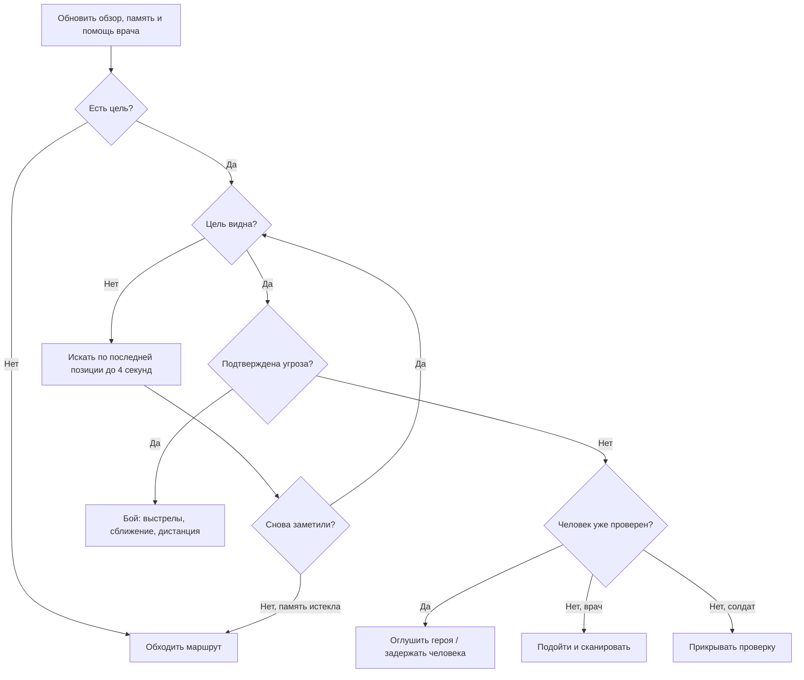

# Дерево поведения NPC

В Unity включи **Play**, открой **Irkutsk → NPC Behavior Tree** и нажми кнопку нужного персонажа. Окно показывает цель, состояние и дерево. Жёлтым выделено выполняемое действие, зелёным — успешная проверка, красным — отказ, серым — узлы, не проверявшиеся в текущем кадре. Это окно наблюдения; состав веток задаётся в `HumanAgent.BuildBehavior()`, перетаскивания узлов пока нет.

Каждый персонаж имеет собственное дерево и собственную память. Селектор проверяет ветки сверху вниз и выбирает первую подходящую. Последовательность выполняет дочерние узлы до отказа или действия в процессе. У узла три результата: успех, отказ и выполнение. Приоритеты проверяются заново каждый кадр, поэтому угроза может сразу прервать мирную проверку.

Перед этой частью проверяются оглушение, смерть и конец забега. Задержанный идёт в карантин, мирный житель ожидает помощи. Мародёр выбирает видимую цель и атакует; его текущие боевые действия сохранены отдельным листом дерева. Заражённые используют прежний AI и в это дерево не переводились.

Здорового героя сначала проверяют, затем пытаются задержать. Подтверждённое заражение или нападение разрешает солдату стрелять. Врач использует дротики; рядом лечит себя и солдата с прежним интервалом. Известная позиция нападавшего передаётся ближайшему напарнику. Обычное обнаружение по-прежнему требует попадания в сектор обзора и прямой видимости.

Потеря цели не даёт NPC знания о её новом положении: он запоминает последнюю видимую позицию. Через 4 секунды без нового контакта цель забывается. Оружие, поиск пути, ограничения сканера и результаты проверки героя остаются отдельными игровыми системами; дерево выбирает, какое действие сейчас выполнять.
