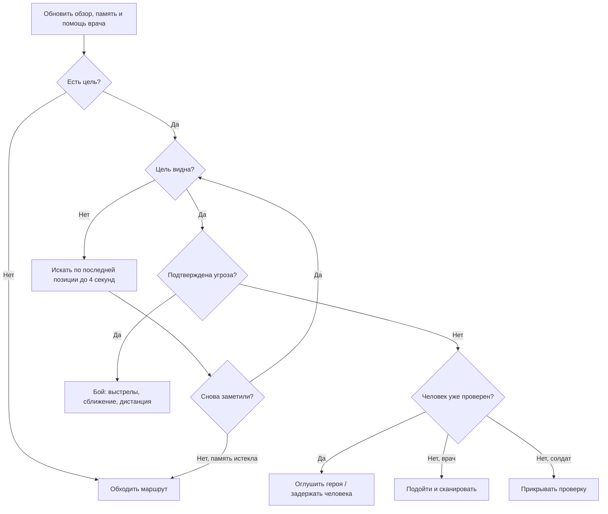

# Дерево поведения NPC

В Unity включи **Play**, открой **Irkutsk → NPC Behavior Tree** и нажми кнопку нужного персонажа. Окно показывает цель, состояние и дерево. Жёлтым выделено выполняемое действие, зелёным — успешная проверка, красным — отказ, серым — узлы, не проверявшиеся в текущем кадре. Это окно наблюдения; состав веток задаётся в `HumanAgent.BuildBehavior()`, перетаскивания узлов пока нет.

Каждый персонаж имеет собственное дерево и собственную память. Селектор проверяет ветки сверху вниз и выбирает первую подходящую. Последовательность выполняет дочерние узлы до отказа или действия в процессе. У узла три результата: успех, отказ и выполнение. Приоритеты проверяются заново каждый кадр, поэтому угроза может сразу прервать мирную проверку.

Перед этой частью проверяются оглушение, смерть и конец забега. Задержанный идёт в карантин. Мирные, мародёры и заражённые теперь тоже имеют собственные ветки дерева; заражённых можно выбрать в окне наблюдения.

Здорового героя сначала проверяют, затем пытаются задержать. Подтверждённое заражение или нападение разрешает солдату стрелять. Врач использует дротики; рядом лечит себя и солдата с прежним интервалом. Известная позиция нападавшего передаётся ближайшему напарнику. Обычное обнаружение по-прежнему требует попадания в сектор обзора и прямой видимости.

Потеря цели не даёт NPC знания о её новом положении: он запоминает последнюю видимую позицию. Через 4 секунды без нового контакта цель забывается. Оружие, поиск пути, ограничения сканера и результаты проверки героя остаются отдельными игровыми системами; дерево выбирает, какое действие сейчас выполнять.

## Реакции разных NPC

- **Мирный:** замечает заражённого или мародёра в секторе до 8 м, пугается выстрела до 8 м (до 3 м через стену), запоминает опасное место на 6 секунд и уходит от него. После успокоения возвращается на исходное место. Не стреляет в ответ; просьба о лекарстве остаётся доступной рядом с ним.
- **Врач:** при здоровье напарника ниже 65 подходит к нему с расстояния до 12 м, если рядом нет непосредственной видимой угрозы. Лечит только вблизи, с интервалом 8 секунд. При собственном здоровье ниже 50 отступает с дротиками.
- **Солдат:** не стреляет по центральной линии через других персонажей, смещается в сторону, затем возобновляет огонь. При здоровье ниже 35 ищет более безопасную позицию и может вести ответный огонь. Подтверждённая угроза или позиция нападавшего передаётся патрульным в радиусе 12 м.
- **Мародёр:** удерживает цель, ищет её последнюю позицию до 4 секунд, меняет перекрытую позицию, отходит от слишком близкой цели. При здоровье ниже 40 отступает, продолжая стрелять при видимом противнике.
- **Заражённый:** прислушивается к одиночному слабому звуку, после накопления подозрения начинает поиск с прежней задержкой. Видимую добычу помнит 6 секунд, источник шума или удара — 4 секунды; после прибытия осматривает соседние точки. Укус требует замаха 0,35 с; если цель ушла из зоны удара, замах сбрасывается.

Отступление выбирает из нескольких ближайших свободных точек, предпочитая увеличение расстояния и закрывающие обзор препятствия. Это простой локальный выбор, а не полноценное планирование укрытий и обходов с фланга. Центральная линия огня проверяется до выстрела, но разброс сохраняется. Небольшое взаимное расталкивание уменьшает скопления, не гарантируя отсутствие всех застреваний в тесных местах. Дальность зрения и слуха заражённых не увеличена.
