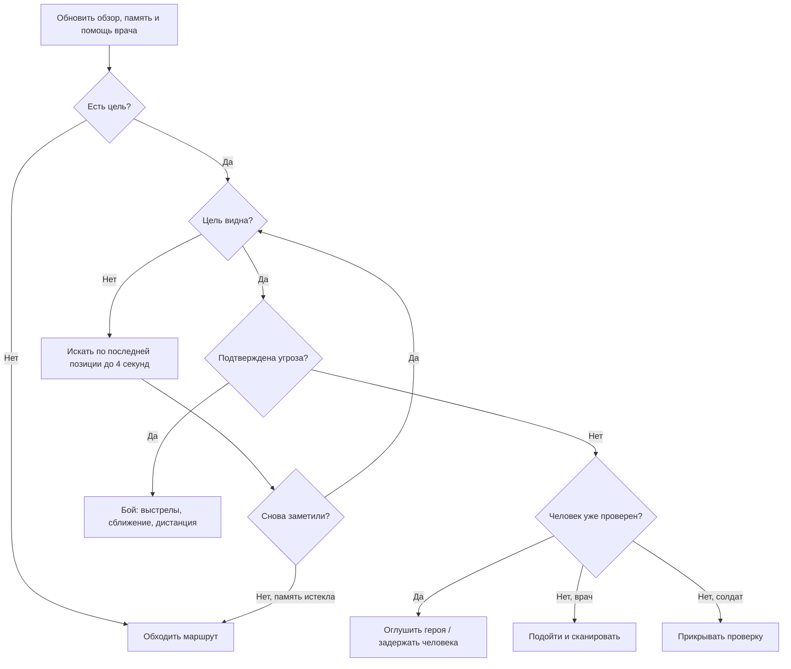

# Дерево поведения NPC

В Unity включи **Play**, открой **Irkutsk → NPC Behavior Tree** и нажми кнопку нужного персонажа. Окно показывает цель, состояние и дерево. Жёлтым выделено выполняемое действие, зелёным — успешная проверка, красным — отказ, серым — узлы, не проверявшиеся в текущем кадре. Это окно наблюдения; состав веток задаётся в `HumanAgent.BuildBehavior()`, перетаскивания узлов пока нет.

Каждый персонаж имеет собственное дерево и собственную память. Селектор проверяет ветки сверху вниз и выбирает первую подходящую. Последовательность выполняет дочерние узлы до отказа или действия в процессе. У узла три результата: успех, отказ и выполнение. Приоритеты проверяются заново каждый кадр, поэтому угроза может сразу прервать мирную проверку.

Перед этой частью проверяются оглушение, смерть и конец забега. Задержанный идёт в карантин. Мирные, мародёры и заражённые теперь тоже имеют собственные ветки дерева; заражённых можно выбрать в окне наблюдения.

Здорового героя сначала проверяют, затем пытаются задержать. Подтверждённое заражение или нападение разрешает солдату стрелять. Врач использует дротики; рядом лечит себя и солдата с прежним интервалом. Известная позиция нападавшего передаётся ближайшему напарнику. Обычное обнаружение по-прежнему требует попадания в сектор обзора и прямой видимости.

Потеря цели не даёт NPC знания о её новом положении: он запоминает последнюю видимую позицию. Через 4 секунды без нового контакта цель забывается. Оружие, поиск пути, ограничения сканера и результаты проверки героя остаются отдельными игровыми системами; дерево выбирает, какое действие сейчас выполнять.

## Реакции разных NPC

- **Мирный:** замечает заражённого или мародёра в секторе до 8 м, пугается выстрела до 8 м (до 3 м через стену), запоминает опасное место на 6 секунд и уходит от него. После успокоения возвращается на исходное место. Не стреляет в ответ; просьба о лекарстве остаётся доступной рядом с ним.
- **Врач:** при здоровье напарника ниже 65 подходит к нему с расстояния до 12 м, если рядом нет непосредственной видимой угрозы. Лечит только вблизи, с интервалом 8 секунд. При собственном здоровье ниже 50 отступает с дротиками.
- **Солдат:** не стреляет по центральной линии через других персонажей, смещается в сторону, затем возобновляет огонь. При здоровье ниже 35 ищет более безопасную позицию и может вести ответный огонь. Подтверждённая угроза или позиция нападавшего передаётся патрульным в радиусе 12 м.
- **Мародёр:** удерживает цель, ищет её последнюю позицию до 4 секунд, меняет перекрытую позицию, отходит от слишком близкой цели. При здоровье ниже 40 отступает, продолжая стрелять при видимом противнике.
- **Заражённый:** прислушивается к одиночному слабому звуку, после накопления подозрения начинает поиск с прежней задержкой. Видимую добычу помнит 6 секунд, источник шума или удара — 4 секунды; после прибытия осматривает соседние точки. Укус требует замаха 0,35 с; если цель ушла из зоны удара, замах сбрасывается.

Отступление выбирает из нескольких ближайших свободных точек, предпочитая увеличение расстояния и закрывающие обзор препятствия. Это простой локальный выбор, а не полноценное планирование укрытий и обходов с фланга. Центральная линия огня проверяется до выстрела, но разброс сохраняется. Небольшое взаимное расталкивание уменьшает скопления, не гарантируя отсутствие всех застреваний в тесных местах. Дальность зрения и слуха заражённых не увеличена.

## Этап 1 — слух людей и обмен информацией

Солдат, врач и мародёр получают события шума с местом, громкостью и типом. Обычные шаги слышны до 2,5 м, бег и ремонт — до 6 м, удар рукой — до 4 м, вскрытие магазина — до 8 м, двигатель — до 10 м, выстрел героя — до 14 м, NPC — до 12 м. Стена на прямом пути звука уменьшает радиус до 40%. Это простая модель приглушения, без распространения звука через двери и коридоры.

Один тихий звук вызывает прислушивание до 2,5 с без движения. Два близких тихих звука за этот интервал либо один громкий создают зацепку. Звуки обрабатываются не чаще четырёх раз в секунду; выстрелы имеют приоритет и не теряются из-за шагов в том же кадре. Патруль игнорирует свои и напарников выстрелы как подозрительные источники. Ctrl не создаёт шума шагов.

Зацепка содержит приблизительную точку на сетке 2 м и живёт до 8 с после последнего подтверждающего звука. NPC ждёт 0,4 с, затем идёт к ней со скоростью 1,35 м/с и осматривается 2 с после прибытия. Недавняя проверенная точка не проверяется повторно 2,5 с из-за обычного шума; свежий выстрел позволяет проверить её снова. Слышимость не ограничивается сектором зрения. Вне поля зрения звук не даёт личности источника и не разрешает стрельбу; скрытое перемещение источника не обновляет зацепку без нового звука.

В деревья добавлены ветки «Прислушаться» и «Осторожно проверить». Видимая цель и помощь раненому сохраняют приоритет. После зрительного обнаружения звуковая зацепка отменяется и начинается обычная проверка либо бой по прежним правилам. Поиск потерянной цели идёт к последней известной позиции со скоростью 1,6 м/с, безрезультатный поиск заканчивается через прежние 4 с.

Патруль сообщает напарнику в пределах 12 м снимок замеченной позиции, с интервалом 1,5 с между такими сообщениями. Получатель может повернуться и искать там, но не знает нового скрытого положения цели. Нейтральное сообщение не прерывает текущую визуальную проверку или поиск известной угрозы; сообщение о подтверждённой угрозе может прервать мирную проверку. В окне наблюдения показана активная звуковая зацепка.

В этом этапе новые укрытия, приседание, спасение тяжелораненых и сбор добычи мародёром не добавлялись; это следующие согласованные этапы.

## Этап 2 — укрытия и высота персонажа

Добавлены `CoverObstacle` и бронируемые места `CoverSlot`, низкий и высокий префабы. В основной сцене они не размещены. Солдат, врач и мародёр могут выбрать защищённое доступное место, присесть за низким препятствием, выйти к точке выглядывания, выстрелить при видимости и вернуться. Занятое место недоступно другим; бронь освобождается при уходе, отключении, смерти или по истечении аренды.

Персонаж получает `ActorPosture`: C меняет высоту героя с 1,8 до 1 м, коллайдер и кубический силуэт, высоту глаз и оружия. Встать под низким потолком нельзя. Обзор проверяет голову и корпус, туман войны скрывает персонажей с учётом позы, а пули сталкиваются с геометрией. Передвижение в приседе медленное, его шум — 1,25 м; Ctrl по-прежнему бесшумен.

Проверочная сцена **Irkutsk → Open Cover Sandbox** содержит образцы отдельно от основной карты. Для добавления будущих препятствий и настройки своих объектов смотри [инструкцию укрытий](CoverGuide.md). Распределение боевых ролей и спасение тяжелораненых остаются следующими этапами.

## Этап 3 — тактика пары и безопасная помощь

В подтверждённом бою солдат и врач выбирают удержание, сближение, отход, смену линии огня или укрытие. Решение удерживается около 0,9 с; близкий противник, перекрытый путь и опасность лечения могут немедленно его прервать. Сближение идёт короткими доступными отрезками до 2 м. При отсутствии продвижения NPC прекращает попытку, выдерживает паузу и оценивает позицию снова. Потерянная цель ищется по прежней памяти, без чтения её скрытого положения.

В пределах 12 м живые активные напарники согласуют перемещения: один перемещается, другой удерживает позицию и стреляет при видимости и свободной линии. Выглядывание из укрытия тоже учитывается как перемещение. Сильное ранение или противник ближе 2,5 м разрешают срочный отход обоим. При выключенном, оглушённом, погибшем или удалённом напарнике NPC действует самостоятельно. Солдат прикрывает подход врача к раненому.

Врач не лечит в течение 1,25 с после попадания в него или пациента. Он проверяет свою и переданную напарником память об угрозах, близость врага до 7 м и перекрывающую обзор геометрию. Для подхода проверяются прямой свободный путь и четыре точки на нём. Если путь опасен или перекрыт, помощь откладывается; врач продолжает бой, удерживает позицию либо отступает. Это ограниченная локальная оценка, без расчёта всех возможных обходов. Лечение по-прежнему восстанавливает 15 HP с интервалом 8 с и дистанции до 3 м, теперь также требует отсутствия стены между врачом и пациентом.

В окне **Irkutsk → NPC Behavior Tree** показаны тактическая задача и оставшееся время удержания. Для ручной проверки пары в отдельной песочнице: F7 включает бой, F9 добавляет врача, F10 понижает здоровье живого солдата до 40 HP. Спасение и поднятие тяжелораненых относится к этапу 4.

## Этап 4 — тяжёлое ранение и спасение

У солдат и врачей появилось состояние `IsIncapacitated`, отдельное от окончательной смерти `Downed`. Первое попадание, оставившее здоровье от 0 до −40 без включения нижней границы, выводит патрульного из боя. Он падает, освобождает укрытие, перестаёт ходить, стрелять, сканировать и задерживать. Капсула движения отключается; лежащее тело сохраняет отдельный коллайдер и остаётся доступным для попаданий. Подпись показывает 30-секундный срок до гибели.

Сильный избыточный урон (здоровье ≤ −40), повторное смертельное ранение после поднятия, 20 единиц урона после брони по лежащему либо истечение 30 с завершают жизнь окончательно. Поднять можно один раз за забег. Денежный штраф и потеря репутации за убийство начисляются при смерти, а не при падении; при истечении таймера учитывается источник ранения, при добивании — источник последнего урона. Повторные попадания по погибшему не повторяют штраф. Мирный и мародёр сохраняют прежнюю модель смерти.

Напарники замечают раненого в секторе до 12 м или слышат его местный крик: до 12 м без стены, до 5 м через стену. Крик сообщает только фиксированное место раненого. Спасение доступно в пределах 12 м, требует безопасных позиций и маршрута. Проверяются попадания за последние 1,25 с, последняя известная угроза в пределах 12 м у спасателя и ближайших активных патрульных, перекрытие обзора геометрией. Поиск не читает скрытое положение врага. За низким укрытием помощь возможна, если оно закрывает места спасателя, пациента и путь к нему.

Спасатель выбирает одну из восьми точек подхода рядом с телом и проверяет прямой путь либо существующую сетку обхода. На отрезках проверяются промежуточные точки. Неудачные планы пересматриваются не чаще раза в 0,5 с; подход ограничен 10 с. У раненого один спасатель с обновляемой арендой 0,75 с. Приоритет получает доступный врач. Другой солдат рядом удерживает позицию и прикрывает спасение, стреляя только по видимой подтверждённой угрозе со свободной линией огня.

С дистанции до 1,65 м врач приседает и помогает 3 с, возвращая 40 HP. Солдат может оказать первую помощь врачу или другому солдату за 6 с, возвращая 25 HP. Стена между ними блокирует помощь. Новая опасность, попадание, оглушение, отключение, уход пациента или гибель прерывают действие, сбрасывают прогресс и освобождают бронь. При улучшении ситуации попытка возможна снова. Поднятый NPC приходит в себя 0,8 с и возвращается к обычному дереву поведения. Это помощь на месте; перенос тел и скелетная анимация не добавлены.

В песочнице F11 тяжело ранит солдата, F12 — врача; F6 добавляет третьего солдата для проверки прикрытия. F9 включает врача, F7 — активность патруля. В окне дерева видны срок до гибели, пациент и прогресс спасения. Новые укрытия на основную карту не добавлялись.
