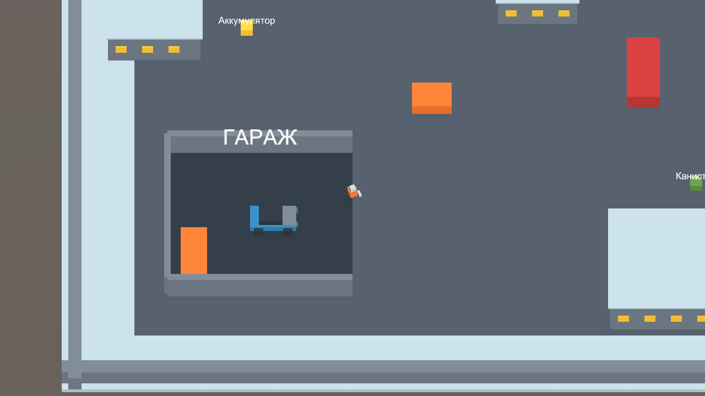
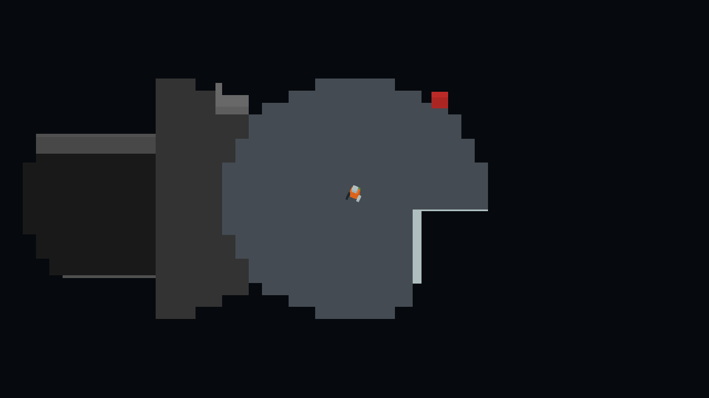
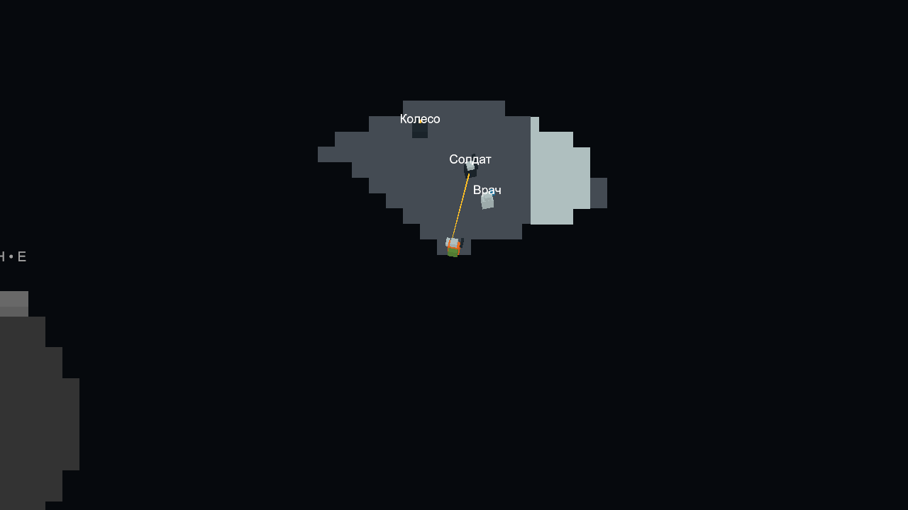
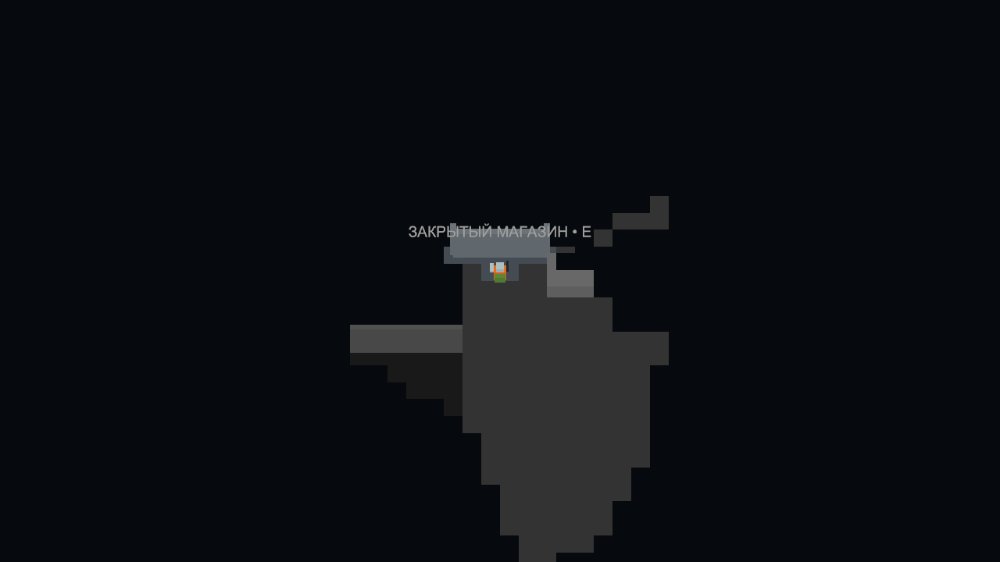

# Побег из Иркутска — первый прототип

Unity **6000.6.6f1**, Universal Render Pipeline, Input System. Простая графика из цветных кубов, камера сверху. Без платных ассетов.

## Запуск

Открой проект в Unity Hub. Открой `Assets/Scenes/EscapePrototype.unity` и нажми Play. Если сцена ещё не создана, выбери меню **Irkutsk → Create prototype scene**. Не создавай сцену во время Play.

На компьютере, где собран прототип, можно сразу открыть `PlayPrototype.cmd` или `Builds/Windows/EscapeFromIrkutsk.exe`. В GitHub хранятся исходники: готовая сборка находится локально и не включена в репозиторий.

## Цель

Найди четыре детали: аккумулятор, двигатель, колесо и канистру. Вместимость рюкзака — две детали. Приноси их к синей машине в гараже и устанавливай кнопкой E (по одной за нажатие). Когда установлены все четыре, нажми E у машины, выезжай из гаража на восток и следуй по трассе до зелёной линии. Смерть героя или разрушение машины — поражение.

## Управление

| Кнопка | Действие |
| --- | --- |
| WASD | Ходьба; в машине W/S — газ, торможение и задний ход, A/D — руль |
| Мышь | Направление взгляда и выстрела |
| Ctrl (удерживать) | Медленный бесшумный шаг; зомби всё ещё видят героя |
| Shift | Бег: быстрее, но слышно дальше |
| E | Поднять деталь, установить одну деталь, сесть в готовую машину |
| ЛКМ / Space | Удар рукой: урон, короткое оглушение и отталкивание |
| ПКМ / Q | Выстрел: небольшой урон, оглушение на 1,6 секунды; громкий шум |
| R | Перезарядка за 1,5 секунды; запас патронов бесконечный для тестирования |
| F5 | Перезапуск |

## Дерево поведения людей

Все NPC используют деревья поведения. Патруль обходит карту, проверяет людей, задерживает или вступает в бой; после потери контакта ищет последнюю позицию. Солдат обходит перекрытую напарником линию огня, врач подходит к раненому солдату. Сильно раненые бойцы отступают и ищут доступное место с укрытием. Мародёр сохраняет цель в памяти и осторожнее действует при ранениях. Мирные уходят от видимых угроз, близких выстрелов и нанесённого им урона; после успокоения возвращаются на исходное место.

Приоритеты перепроверяются каждый кадр. Включи **Play → Irkutsk → NPC Behavior Tree**, выбери человека или заражённого кнопкой: окно показывает его цель и текущие ветки. Это просмотр дерева; изменение структуры пока выполняется в коде. Дополнительные пакеты не требуются. [Схема и правила](Docs/NpcBehavior.md).

## Зомби

Три заражённых в городе и пять на трассе. Их зрение — **6 м, сектор 100°**; у героя — **10 м, сектор 120°**. Заражённые могут заметить героя первыми. Они атакуют не только героя, но и видимых людей, включая патруль и мародёра.

Заражённый удерживает выбранную добычу, преследует видимую цель и после потери контакта осматривает её последнюю позицию и ближайшие точки. Скрытое перемещение цели ему неизвестно. Перед укусом есть **замах 0,35 с** с выдвижением рук и надписью; уход из досягаемости отменяет удар. Люди и заражённые слегка расходятся при тесном сближении. Если путь не найден, заражённый перестаёт идти прямо в стену.

Слух ослаблен: шаги — 2,5 м, бег — 6 м, удар — 4 м, ремонт — 6 м, вскрытие магазина — 8 м. Громкие звуки ограничены слухом заражённого до 9 м; через стены дальность дополнительно уменьшается. **Ctrl не создаёт шума шагов.** Один тихий звук только настораживает («? ШУМ»). Повторный тихий или один громкий запускает поиск с задержкой около 0,9 с. Прямое попадание и визуальное обнаружение по-прежнему вызывают быструю реакцию.

## Туман войны

Неисследованная территория полностью скрыта. В текущем обзоре окружение цветное; после ухода остаётся серой запомненная местность. Зомби, машина, предметы и подписи добычи вне текущего обзора не показываются. Исчезают и надписи состояния над заражёнными. Стены перекрывают обзор; расстояние обзора — 10 метров пешком и 14 в машине. Исследованность сбрасывается при перезапуске забега (F5).

К сектору добавлен небольшой круг ближней видимости: **1,5 м вокруг героя** и 2,2 м вокруг управляемой машины. Он помогает видеть рядом и за спиной, но также перекрывается стенами.

Первый вариант использует чёткую сетку с ячейкой 1 метр и обновляет обзор 10 раз в секунду. Статичное окружение этой карты не меняется; система памяти изменяемых дверей/зданий потребуется вместе с появлением таких объектов.

## Границы прототипа

Нет кооператива, таймера орды, постоянного поселения и сохранений между забегами. Есть тестовая экономика, заражение от укусов, помощь жителю, вскрытие закрытого магазина, патруль и одна бронепластина. Торговца на карте нет. Это проверка цикла «собрать → отремонтировать → уехать» и моральных решений на одной карте. Мир создаётся при запуске из кода; исходная SampleScene сохранена.

## Небольшой социальный тест

- Житель в синей одежде стоит рядом с гаражом. E открывает просьбу: принести лекарство за **35 ₽ и 4 репутации**. Награда выдаётся один раз. Лекарство занимает один из двух слотов рюкзака.
- Бесплатная красная коробка лекарства лежит севернее гаража. Ещё одна коробка находится в закрытом пустом магазине севернее стартовой точки. У рольставней нажми E, чтобы прочитать подсказку, закрой окно и **удерживай F 3 секунды**. Можно сразу удерживать F у двери. Вскрытие создаёт шум; отпускание F или уход сбрасывает прогресс.
- После вскрытия войди внутрь. Товар подписан **«ЧУЖОЕ»**; E рядом забирает лекарство: **−10 репутации, без денежного штрафа**. Повторная кража одной коробки невозможна. Покупки в этом магазине нет.
- Стартовые деньги — **60 ₽**, репутация — **0**. Последние события показаны слева; **J** открывает полный журнал текущего забега, **Esc** закрывает окна. Счётчики сбрасываются при F5: постоянные сохранения не входят в этот тест.
- Врач в белом и солдат в тёмной броне **обходят карту по маршрутам**, оглядываются и строят путь вокруг зданий. Обзор — **12 м, сектор 110°**. Проверяют героя и других встреченных NPC. Врач сканирует при прямой видимости в пределах **3,2 м** в течение 2 секунд. До результата проверки и признаков агрессии патруль не открывает боевой огонь. Здоровых пытаются задержать; проверенные мирные NPC идут в карантинную точку.
- Подтверждённое заражение или замеченное нападение переводит патруль к бою. Солдат стреляет, врач применяет оглушающие дротики; на очень близкой дистанции патруль отступает, а не стоит поверх цели. После потери цели некоторое время ищет её в последнем известном месте, затем возвращается к обходу.
- На карте добавлен **мародёр в красной одежде**. Он ходит и нападает на героя, патруль или заражённых. Его замеченная агрессия является поводом для ответа патруля. Убийство мародёра не штрафуется как убийство мирного. Смерть NPC от другого NPC не отнимает деньги и репутацию героя.
- Здорового пытаются задержать: контакт с патрулём в течение **3 секунд** завершает забег конфискацией добычи. Можно убежать и сбросить прогресс задержания. Заражение от укусов достигает порога болезни при **40%**; положительный результат сканирования разрешает солдату стрелять. Выстрел героя на глазах у патруля либо атака на патруль также вызывает ответный огонь.
- Убийство мирного или врача: **−25 репутации и штраф 60 ₽**. Убийство солдата: **−15 репутации и штраф 40 ₽**. Штраф применяется один раз, деньги не уходят ниже нуля. Пистолет и удар действуют и на людей, поэтому важно выбирать цель.
- Серый куб бронепластины лежит восточнее гаража. Занимает один слот; принеси к машине и нажми E. На кузове появляются листы, добавляются **50 единиц защиты**, которые поглощают повреждения раньше корпуса. Броня для выезда не обязательна.
- За успешный выезд один раз начисляется **100 ₽ + сохранившаяся прочность машины** и **8 репутации**. Уже применённые штрафы повторно не вычитаются.

NPC, добыча и их подписи скрываются туманом войны. Поведение патруля — простая тестовая погоня с обходом ближайших препятствий; сложные маршруты, диалоги и постоянные отношения отложены.

Солдат стреляет физически проверяемыми лучами: разброс до ±5° по горизонтали и ±2° по вертикали, видимый трассер на 0,22 секунды. Урон возникает только при попадании; стены останавливают пулю. Выстрел солдата создаёт шум для заражённых. При повреждении вспыхивают красные края экрана и показывается потерянное здоровье либо повреждение машины/брони.

Попадание по патрульному, в том числе со спины, даёт ему позицию нападавшего и передаётся напарнику в пределах 12 м. Они разворачиваются и ищут героя; стены по-прежнему перекрывают стрельбу и обзор. Патруль удерживает видимую текущую цель, поэтому соседний NPC не сбрасывает проверку или бой. Врач стреляет видимыми дротиками с проверкой попадания: здорового героя после сканирования пытаются оглушить и задержать, по заражённому или напавшему солдат открывает огонь.

Меню **Irkutsk → Create prototype scene** создаёт стартовую сцену. Метод `IrkutskPrototype.PrototypeBuilder.BuildWindows` собирает Windows-версию в `Builds/Windows/`; сборки и Unity-кэши не отправляются в Git.

Результаты автоматических проверок — в [VALIDATION.md](VALIDATION.md).

Версия тумана войны от 22 октября, до замены круга сектором:

Текущая версия от 23 октября — сектор героя и трассер солдата:

